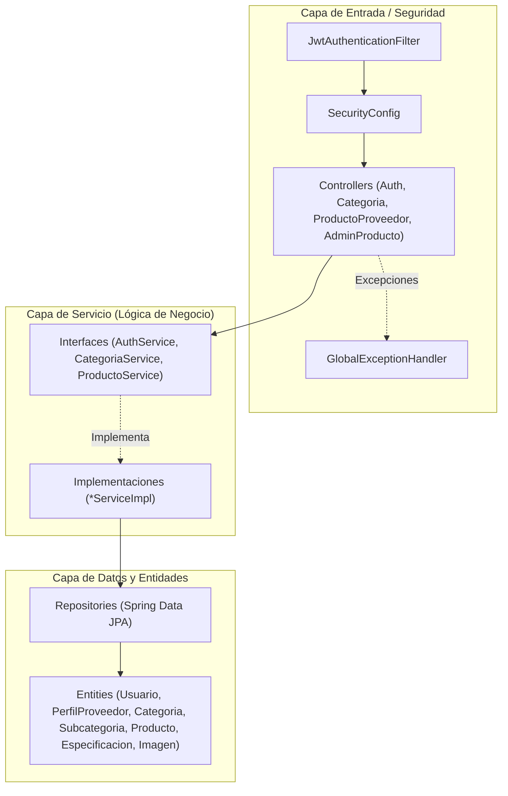

# ARCHITECTURE.md — Arquitectura del Backend (`compunex-backend`)

> **Área Técnica:** Backend  
> **Fase del SDLC:** Fase 02 · Diseño y Arquitectura  
> **Paquete Raíz:** `com.compunex.b2b`

---

## 🏛️ 1. Definición Arquitectónica del Proyecto

* **Estilo Arquitectónico:** Monolito Modular organizado por **Capas** (`controller` → `service` → `repository` → `entity`) y **Dominios de Negocio** (`modules.auth`, `modules.catalogo`, `modules.perfiles`).
* **Criterio de Selección:** Facilita la trazabilidad por módulo, cumple con la convención `camelCase` de paquetes requerida por la rúbrica, y permite pruebas unitarias e integración aisladas por capa (`@WebMvcTest`, `@DataJpaTest`, Mockito).

---

## 🧱 2. Capas y Flujo de Dependencias



---

## 📁 3. Estructura Real de Paquetes (`src/main/java/com/compunex/b2b`)

```text
com.compunex.b2b/
├── CompunexBackendApplication.java
├── config/                  # DataInitializer, OpenApiConfig, SecurityConfig
├── exception/               # GlobalExceptionHandler
├── security/                # JwtTokenProvider, JwtAuthenticationFilter, CustomUserDetailsService
└── modules/
    ├── auth/
    │   ├── controller/      # AuthController
    │   ├── dto/             # request/ y response/
    │   ├── entity/          # Usuario, RolUsuario, EstadoUsuario
    │   ├── exception/       # ContrasenaActualIncorrectaException
    │   ├── repository/      # UsuarioRepository
    │   └── service/         # AuthService + impl/AuthServiceImpl
    ├── catalogo/
    │   ├── controller/      # CategoriaController, ProductoProveedorController, AdminProductoController
    │   ├── dto/             # request/ y response/
    │   ├── entity/          # Categoria, Subcategoria, Producto, ProductoEspecificacion, ImagenProducto, enums
    │   ├── repository/      # CategoriaRepository, ProductoRepository
    │   └── service/         # CategoriaService, ProductoService + impl/
    └── perfiles/
        ├── entity/          # PerfilProveedor
        └── repository/      # PerfilProveedorRepository
```

---

## ⚙️ 4. Decisiones de Configuración Pendientes (Deuda Técnica `DT-01` / `DT-02`)

1. **Perfiles y variables de entorno:** Separar `application.properties` base (`spring.profiles.active=${SPRING_PROFILES_ACTIVE:dev}`) en `application-dev.properties` y `application-prod.properties`, externalizando `spring.datasource.*` y `jwt.secret`.
2. **Motor de BD:** Confirmar si se mantiene PostgreSQL o se migra a MySQL con usuario dedicado distinto de `root`.
