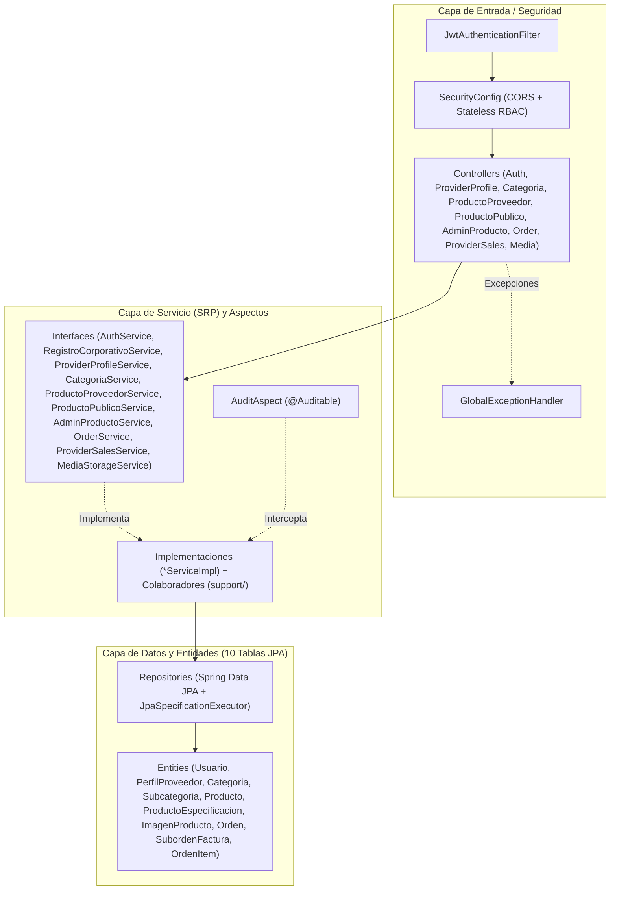

# ARCHITECTURE.md — Arquitectura del Backend (`compunex-backend`)

> **Área Técnica:** Backend  
> **Fase del SDLC:** Fase 02 · Diseño y Arquitectura *(actualizada con implementación real post-Sprint B09 y Refactor SRP)*  
> **Paquete Raíz:** `com.compunex.b2b`  
> **Stack:** Java 21 · Spring Boot 3.5.16 · Spring Security 6 · JJWT 0.12.6 · Spring Data JPA · PostgreSQL 15+ · Springdoc OpenAPI 2.8.9

---

## 🏛️ 1. Definición Arquitectónica del Proyecto

* **Estilo Arquitectónico:** Monolito Modular organizado por **Capas** (`controller` → `service` (+ `support`) → `repository` → `entity`) y **Dominios de Negocio** (`modules.auth`, `modules.perfiles`, `modules.catalogo`, `modules.ordenes`, `modules.media`).
* **Criterio de Selección:** Facilita la trazabilidad por módulo, cumple con la convención `camelCase` de paquetes, evita servicios sobrecargados aplicando **SRP (Opción B)**, y permite pruebas aisladas por capa (`@WebMvcTest`, `@DataJpaTest`, `@SpringBootTest` y Mockito).

---

## 🧱 2. Capas y Flujo de Dependencias



---

## 📁 3. Estructura Real de Paquetes (`src/main/java/com/compunex/b2b`)

```text
com.compunex.b2b/
├── CompunexBackendApplication.java
├── config/                  # DataInitializer, OpenApiConfig, SecurityConfig
│   └── audit/               # Auditable, AuditAspect (@Aspect [AUDIT_LOG])
├── exception/               # GlobalExceptionHandler, BusinessException, DuplicateResourceException, ResourceNotFoundException, ErrorResponseDTO
├── security/                # JwtTokenProvider, JwtAuthenticationFilter, CustomUserDetailsService
└── modules/
    ├── auth/
    │   ├── controller/      # AuthController
    │   ├── dto/             # request/ y response/
    │   ├── entity/          # Usuario, RolUsuario, EstadoUsuario
    │   ├── exception/       # ContrasenaActualIncorrectaException
    │   ├── repository/      # UsuarioRepository
    │   └── service/         # AuthService, RegistroCorporativoService + impl/
    ├── perfiles/
    │   ├── controller/      # ProviderProfileController
    │   ├── dto/             # request/ y response/
    │   ├── entity/          # PerfilProveedor
    │   ├── repository/      # PerfilProveedorRepository
    │   └── service/         # ProviderProfileService + impl/
    ├── catalogo/
    │   ├── controller/      # CategoriaController, ProductoProveedorController, ProductoPublicoController, AdminProductoController
    │   ├── dto/             # request/ y response/ (incl. ProductoPaginadoResponseDTO.from)
    │   ├── entity/          # Categoria, Subcategoria, Producto, ProductoEspecificacion, ImagenProducto, enums
    │   ├── repository/      # CategoriaRepository, ProductoRepository, ProductoSpecification
    │   └── service/         # CategoriaService, ProductoProveedorService, ProductoPublicoService, AdminProductoService + impl/ + support/ (ProveedorContextHelper, ProductoEstadoHelper)
    ├── ordenes/
    │   ├── controller/      # OrderController, ProviderSalesController
    │   ├── dto/             # request/ y response/
    │   ├── entity/          # Orden, SubordenFactura, OrdenItem, EstadoOrden, EstadoSuborden
    │   ├── exception/       # AutoCompraException, StockInsuficienteException
    │   ├── repository/      # OrdenRepository, SubordenFacturaRepository, OrdenItemRepository
    │   └── service/         # OrderService, ProviderSalesService + impl/ + support/ (SplitOrderCalculator, OrderResponseMapper)
    └── media/
        ├── controller/      # MediaController
        ├── dto/             # response/ (MediaUploadResponseDTO)
        └── service/         # MediaStorageService + impl/LocalMediaStorageServiceImpl
```

---

## ⚙️ 4. Decisiones de Configuración (`DT-01` / `DT-02` Resueltas)

1. **Perfiles y variables de entorno (`DT-01` RESUELTO):** Configurados `application.properties`, `application-dev.yml` y `application-prod.yml` externalizando `DB_URL`, `DB_USER`, `DB_PASSWORD`, `JWT_SECRET`, `JWT_EXPIRATION_MS` y `MEDIA_UPLOAD_DIR`.
2. **Motor de BD (`DT-02` RESUELTO):** Confirmado **PostgreSQL 15+** en ejecución (`localhost:5432/compunex_b2b`, verificado en vivo) con base en memoria **H2 en modo PostgreSQL** para pruebas automatizadas (`83/83` tests en verde).
