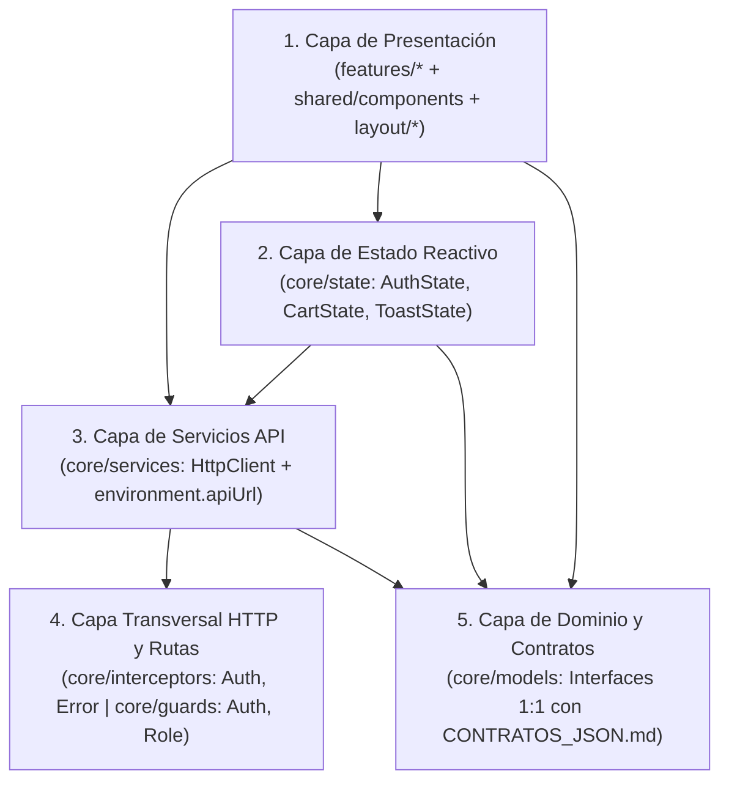

# ARCHITECTURE.md — Arquitectura del Frontend por Capas en Angular (COMPUNEX B2B)

> **Área Técnica:** Frontend (Angular + SASS)  
> **Fase del SDLC:** Fase 02 · Diseño y Arquitectura  
> **Base Metodológica:** Arquitectura Frontend por Capas (adaptada de `01_Arquitectura_Frontend_por_Capas` al ecosistema nativo de Angular, rutas, formularios reactivos, interceptores y SASS).

---

## 🏛️ 1. Definición Arquitectónica del Cliente Web

* **Framework:** Angular (SPA Web) con TypeScript y **SASS (`.scss`)**.
* **Plataforma:** Aplicación **100% Web** responsiva (escritorio y móvil en navegador, sin app móvil nativa).
* **Estilo Arquitectónico:** **Arquitectura por Capas orientada a Features** (*Layered + Feature-Based*), con nomenclatura estricta en **`kebab-case`** para todas las carpetas bajo `src/app/` (Ítem 1 de `Rubrica.pdf`).
* **Layout de Navegación:**
  * **Zona Pública / Comprador (Tienda B2B):** Navbar superior (`layout/store-navbar`) con buscador global, categorías, carrito y acceso/sesión.
  * **Zona Privada (Panel Proveedor / Admin):** Sidebar lateral izquierdo (`layout/panel-sidebar`) + área de trabajo principal.

---

## 🧱 2. Las 5 Capas en Angular (Equivalencia y Reglas de Dependencia)



1. **Capa de Presentación (`features/`, `shared/`, `layout/`):**
   * Componentes *Smart* (páginas conectadas a rutas y servicios) y *Dumb/Presentacionales* (tarjetas, badges, modales, paginador con `@Input()`/`@Output()`).
   * Formularios Reactivos (`ReactiveFormsModule`) con validaciones y mensajes de error debajo de cada campo.
   * Estilos encapsulados en **SASS (`.scss`)** consumiendo tokens globales de `src/styles/`.
2. **Capa de Estado Reactivo (`core/state/`):**
   * Servicios singleton (`providedIn: 'root'`) usando Angular **Signals** (o `BehaviorSubject`) con hidratación segura en `localStorage` para el carrito B2B (`cart-state.service.ts`) y la sesión (`auth-state.service.ts`), más notificaciones (`toast-state.service.ts`).
   * Los componentes nunca manipulan `localStorage` directamente.
3. **Capa de Servicios API (`core/services/`):**
   * Fachadas tipadas con `HttpClient` que importan `environment.apiUrl` (cero URLs quemadas, Ítem 3 de `Rubrica.pdf`).
4. **Capa Transversal HTTP y Seguridad (`core/interceptors/`, `core/guards/`):**
   * `auth.interceptor.ts`: inyecta `Authorization: Bearer <token>` automáticamente.
   * `error.interceptor.ts`: captura `400`, `401` (limpia sesión y redirige a login), `403` (vista/alerta de acceso denegado), `404` y `500`.
   * `auth.guard.ts` y `role.guard.ts`: protegen rutas privadas de comprador, proveedor y admin.
5. **Capa de Dominio y Contratos (`core/models/`):**
   * Interfaces TypeScript espejo exacto de `CONTRATOS_JSON.md` (`AuthResponse`, `ProductoResumen`, `ProductoDetalle`, `CheckoutRequest`, `CheckoutResponse`, `SubordenFactura`, etc.).

---

## 📁 3. Estructura de Carpetas en `kebab-case` (`src/`)

```text
src/
├── environments/
│   ├── environment.ts                 # apiUrl: 'http://localhost:8080/api/v1'
│   └── environment.prod.ts            # apiUrl de producción (fileReplacements en angular.json)
├── styles/
│   ├── _tokens.scss                   # Paleta (#F5F7FA, #2456C6, #142238), tipografía y radios
│   ├── _mixins.scss                   # Breakpoints responsivos (desktop / 375px) y utilidades SASS
│   └── styles.scss                    # Estilos globales y entrada SASS
└── app/
    ├── core/
    │   ├── guards/                    # auth.guard.ts, role.guard.ts
    │   ├── interceptors/              # auth.interceptor.ts, error.interceptor.ts
    │   ├── models/                    # auth.model.ts, catalog.model.ts, order.model.ts, provider.model.ts
    │   ├── services/                  # auth-api.service.ts, catalog-api.service.ts, order-api.service.ts, provider-api.service.ts
    │   └── state/                     # auth-state.service.ts, cart-state.service.ts, toast-state.service.ts
    ├── shared/
    │   └── components/                # product-card, pagination, status-badge, toast-alert, confirm-modal
    ├── layout/
    │   ├── store-navbar/              # Navbar superior de tienda B2B
    │   └── panel-sidebar/             # Sidebar lateral del Panel Proveedor / Admin
    ├── features/
    │   ├── home/                      # P-01 Inicio
    │   ├── categories/                # P-02 Categorías y subcategorías
    │   ├── catalog/                   # P-03, P-04, P-05 Catálogo, ficha técnica y contacto
    │   ├── auth/                      # P-06, P-07 Login y registro de empresa
    │   ├── cart/                      # P-09 Carrito B2B multi-proveedor
    │   ├── checkout-billing/          # P-10, P-11, P-12, P-13 Checkout Split Order y comprobantes simulados
    │   ├── orders/                    # P-14, P-15 Mis compras y detalle de compra
    │   ├── account/                   # P-16, P-17, P-18 Mi cuenta, cambiar clave y activar proveedor
    │   ├── provider-panel/            # P-19..P-26 Dashboard proveedor, CRUD productos, ventas y perfil
    │   ├── admin-panel/               # Moderación global de productos
    │   ├── forbidden/                 # P-36 Acceso denegado (403)
    │   └── not-found/                 # P-37 Página 404 (ruta wildcard '**')
    ├── app.routes.ts                  # Rutas con lazy loading, guards y '**' -> NotFoundComponent
    └── app.config.ts                  # provideHttpClient(withInterceptors([authInterceptor, errorInterceptor]))
```

> 📌 **Flujos y diseños vinculados:** Ver [`FLUJOS_Y_CAMBIOS_PENDIENTES.md`](FLUJOS_Y_CAMBIOS_PENDIENTES.md) y [`Mockups/PROMPTS_GOOGLE_STITCH_TEMPLATE.md`](Mockups/PROMPTS_GOOGLE_STITCH_TEMPLATE.md).
