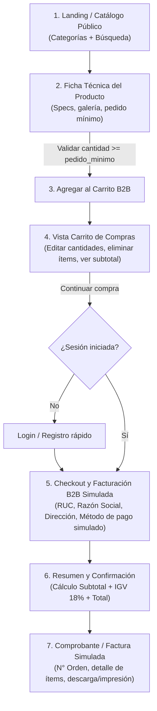
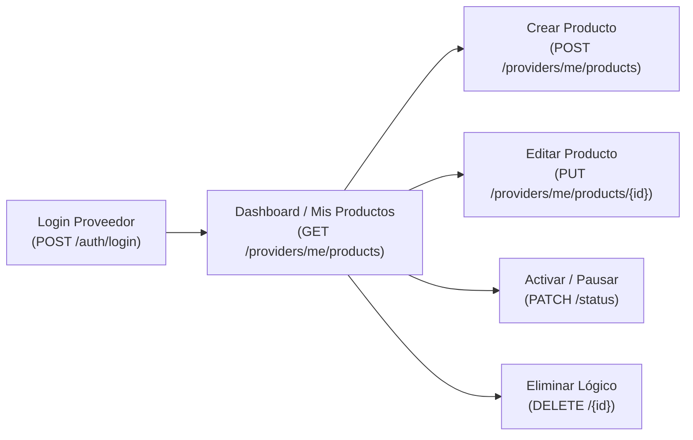
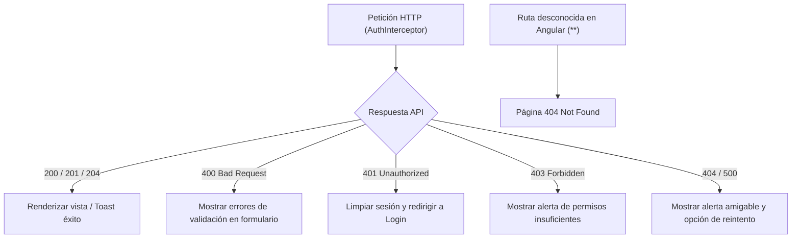

# Flujos de Usuario y Lista de Cambios Pendientes — Front-end B2B Transaccional

> **Área Técnica:** Frontend (Angular)  
> **Fase del SDLC:** Fase 02 · Diseño y Arquitectura  
> **Propósito:** Definir los flujos de navegación y compra B2B (catálogo → carrito → facturación simulada) y llevar el registro de cambios pendientes para actualizar el resto de la documentación (Fase 01 y Fase 02).

---

## 🔄 1. Cambio de Enfoque: De Catálogo Informativo a E-Commerce B2B Transaccional

* **Antes (alcance inicial):** Catálogo solo informativo donde se excluía carrito de compras y facturación.
* **Ahora (nuevo alcance Front-end):** Plataforma **e-commerce B2B transaccional** donde el cliente/empresa puede:
  1. Explorar el catálogo público de hardware por categorías y búsqueda.
  2. Respetar reglas mayoristas (`pedido_minimo`, `unidades_por_paquete`, `precio_unitario_ref`).
  3. Agregar productos a un **Carrito de Compras B2B**.
  4. Pasar a un módulo de **Checkout y Facturación Simulada** (RUC, Razón Social, dirección de entrega, método de pago simulado, cálculo de subtotal/IGV/total y generación de comprobante/orden simulada).

---

## 🗺️ 2. Flujos Principales del Sistema (Frontend)

### 2.1 Flujo 1: Exploración, Carrito y Facturación Simulada (Comprador / Cliente B2B)

### 2.2 Flujo 2: Gestión del Proveedor (`ROLE_PROVEEDOR`)

### 2.3 Flujo 3: Administración de plataforma (`ROLE_ADMIN`)

El administrador accede a la administración general de la plataforma. Sus funciones, permisos y pantallas están pendientes de definición. Cada proveedor gestiona sus propios productos; no se incluye moderación administrativa del catálogo.

### 2.4 Flujo 4: Manejo de Errores y Rutas Inválidas (Transversal)

---

## 📱 3. Pantallas Clave del Cliente (Inventario Inicial para Mockups)

1. **Catálogo Público (`catalog`):** Barra de búsqueda, filtro por categorías, tarjetas de producto con precio referencial y pedido mínimo.
2. **Detalle de Producto (`product-detail`):** Galería de imágenes, tabla de especificaciones técnicas (`clave`/`valor`), selector de cantidad mayorista y botón "Agregar al carrito".
3. **Carrito B2B (`cart`):** Lista de ítems agrupados o detallados, ajuste de cantidades, cálculo de subtotal y botón "Ir a facturación".
4. **Checkout y Facturación Simulada (`checkout-billing`):** Formulario de datos de facturación (RUC, Razón Social, dirección fiscal, tipo de comprobante: Factura / Boleta B2B, método de pago simulado) y vista previa del comprobante generado.
5. **Login / Registro (`auth`):** Acceso unificado y registro de proveedor/cliente.
6. **Panel Proveedor (`products`):** Tabla/cards responsivas con CRUD completo.
7. **Página 404 (`not-found`):** Vista amigable para rutas inexistentes.

---

## 📋 4. Lista de Cambios Pendientes en la Documentación (Por el Cambio a Transaccional)

> *Nota: Estos cambios se aplicarán a los documentos de Fase 01 y Fase 02 una vez que confirmes los flujos y decidas si el carrito/facturación será 100% simulado en Front-end o si también se agregarán endpoints en Back-end.*

| ID | Documento a Actualizar | Cambio Aplicado | Estado |
| :---: | :--- | :--- | :---: |
| **PEND-01** | `01_Fase_Planificacion_y_Analisis/README_RETO.md` | Agregado actor Comprador/Proveedor Dual, Módulo 4 (Carrito y Facturación Simulada Split Order) y actualizado Fuera de alcance. | ✅ Actualizado |
| **PEND-02** | `01_Fase_Planificacion_y_Analisis/02_Requisitos_y_Alcance/README.md` | Agregados `RF-011` a `RF-014` (Catálogo público, Carrito B2B, Checkout Split Order e Historial). | ✅ Actualizado |
| **PEND-03** | `02_Fase_Diseno_y_Arquitectura/DOMAIN.md` | Agregadas entidades `OrdenCompra`, `SubordenFactura`, `OrdenItem` y reglas `RN-007`, `RN-008`. | ✅ Actualizado |
| **PEND-04** | `02_Fase_Diseno_y_Arquitectura/02_Frontend/ARCHITECTURE.md` | Agregados módulos `features/catalog/`, `features/cart/`, `features/checkout-billing/`. | ✅ Actualizado |
| **PEND-05** | `02_Fase_Diseno_y_Arquitectura/03_Base_de_Datos/ARCHITECTURE.md` y `05_Integracion_y_APIs/` | Agregadas tablas `ordenes`, `subordenes_factura`, `orden_items` y contratos JSON de los 5 endpoints nuevos (Opción B: Full Back + BD). | ✅ Actualizado |
| **PEND-06** | `02_Fase_Diseno_y_Arquitectura/AUDITORIA_COHERENCIA_FASE1_A_FASE2.md` | Agregados `RF-011` a `RF-014` en la matriz de trazabilidad. | ✅ Actualizado |
