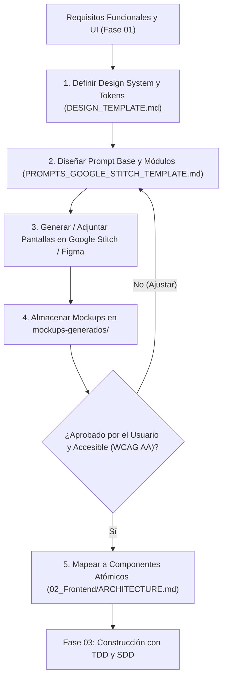

# Mockups y Prototipado Visual de Frontend

> **Área Técnica:** Frontend & UI/UX  
> **Fase del SDLC:** Fase 02 · Diseño y Arquitectura  
> **Propósito:** Definir los tokens de diseño visual, la guía de estilo, la generación de prototipos/pantallas (mediante Google Stitch, Figma o bocetos) y el inventario visual de la aplicación antes de construir componentes en código.

---

## 🤖 Protocolo Obligatorio del Agente de IA con el Usuario

Cuando el proyecto cuente con una interfaz visual (Web, Móvil, Desktop, etc.), el agente de IA **NUNCA debe asumir el diseño visual ni empezar a codificar pantallas sin consultar previamente**.

El agente debe formular de manera explícita la siguiente pregunta al usuario:

> 💬 *"¿Cuentas con bocetos, wireframes o mockups visuales diseñados en **Google Stitch**, **Figma** o herramientas similares para este proyecto?*  
> * *Si ya los tienes:* Por favor adjúntalos o guárdalos en la carpeta `Mockups/mockups-generados/` e indícame tus pautas de diseño para alinearlas con la arquitectura de componentes.*  
> * *Si aún no los tienes:* Podemos definirlos juntos utilizando la plantilla de diseño `DESIGN_TEMPLATE.md` y generar los prompts estructurados para **Google Stitch** con `PROMPTS_GOOGLE_STITCH_TEMPLATE.md` para visualizar las pantallas clave antes de pasar a la fase de construcción."*

---

## 🗺️ Mapa de Contenido del Directorio

```text
Mockups/
├── README.md                           # Este documento guía y protocolo de operación
├── DESIGN_TEMPLATE.md                  # Plantilla neutral de Design System, tokens y accesibilidad
├── PROMPTS_GOOGLE_STITCH_TEMPLATE.md   # Prompts para cada pantalla
├── INVENTARIO_PANTALLAS_POR_ROL.md    # Cobertura, conteo y decisiones pendientes
└── mockups-generados/                  # Carpeta destinada a almacenar las capturas/imágenes exportadas
    └── README.md                       # Pautas para archivar y versionar las capturas de pantalla
```

---

Consulta el [inventario de pantallas por rol](INVENTARIO_PANTALLAS_POR_ROL.md) y los [prompts de diseño](PROMPTS_GOOGLE_STITCH_TEMPLATE.md) para la propuesta actual.

## 🔄 Flujo Metodológico de Diseño Visual



---

## ♿ Criterios de Accesibilidad y Calidad Visual (No Negociables)

1. **Áreas Táctiles Mínimas:** En interfaces táctiles y móviles, todo elemento interactivo (botones, enlaces, iconos de acción) debe tener un área mínima de **48 × 48 dp / px**, con separación adecuada para evitar toques accidentales.
2. **Contraste de Color WCAG 2.1 AA:**
   * Texto normal (< 18 pt o < 14 pt negrita): Ratio de contraste mínimo de **4.5:1** contra el fondo.
   * Texto grande (≥ 18 pt o ≥ 14 pt negrita) y componentes esenciales de UI: Ratio mínimo de **3:1**.
   * **Regla estricta:** Nunca depender exclusivamente del color para comunicar estados o errores (acompañar siempre de iconos y texto explícito).
3. **Escala de Texto y Tipografía:**
   * Texto de cuerpo mínimo de **16 sp / px**.
   * Etiquetas y notas secundarias mínimo de **14 sp / px**.
   * Debe soportar escalado tipográfico del sistema de hasta un **200%** sin truncar textos críticos ni romper el layout.
4. **Estados de Interfaz Obligatorios:**
   Cada pantalla o módulo debe prever visualmente:
   * **Estado Inicial / Ideal:** Con datos cargados.
   * **Estado Vacío (Empty State):** Explicación clara y llamada a la acción para comenzar.
   * **Estado de Carga (Loading State):** Skeleton loaders o spinners contextuales.
   * **Estado de Error:** Mensaje legible en lenguaje de usuario con acción de reintento.
   * **Estado Desconectado (Offline):** Indicador visual no invasivo cuando no hay conexión.
