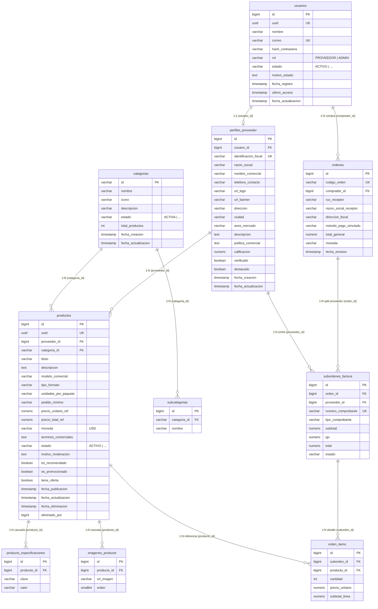

# ARCHITECTURE.md — Arquitectura de Base de Datos y Persistencia (COMPUNEX B2B)

> **Cambio de alcance:** La moderación administrativa de productos fue retirada por decisión del usuario. Las referencias técnicas existentes a `admin/products` o `motivo_moderacion` describen el diseño o implementación anterior y están pendientes de revisión; no son funciones objetivo vigentes.

> **Área Técnica:** Base de Datos  
> **Fase del SDLC:** Fase 02 · Diseño y Arquitectura  
> **Modelo, Normalización y Diccionario:** Ver [`MODELO_Y_DICCIONARIO_BD.md`](MODELO_Y_DICCIONARIO_BD.md)

---

## 🏛️ 1. Definición Arquitectónica de Persistencia

* **Paradigma de Datos:** Relacional (SQL) normalizado con integridad referencial estricta.
* **Motor Actual:** **PostgreSQL** (`org.postgresql:postgresql` en `pom.xml`, `compunex_b2b`). *(Nota pendiente de confirmar para entrega ATF3: posible migración a **MySQL** con usuario dedicado ≠ `root`).*
* **Motor de Pruebas Locales (TDD):** **H2 In-Memory** (`com.h2database:h2` en scope `test`).
* **Gestión de Esquema:** JPA / Hibernate (`spring.jpa.hibernate.ddl-auto=update`) y carga inicial de datos maestros vía `DataInitializer.java`.

---

## 🧱 2. Modelo Entidad-Relación Real (7 Tablas)

---

## 🔒 3. Estrategia de Integridad y Consultas

1. **Borrado Lógico:** La tabla `productos` preserva la trazabilidad histórica registrando `fecha_eliminacion` y `eliminado_por` en lugar de eliminar físicamente la fila.
2. **Optimización N+1:** Las colecciones `especificaciones` e `imagenes` de `Producto` utilizan `@BatchSize(size = 20)` y `orphanRemoval = true`.
3. **Unicidad de Identidad:** `usuarios.correo`, `usuarios.uuid`, `productos.uuid` y `perfiles_proveedor.identificacion_fiscal` tienen restricción `UNIQUE`.
