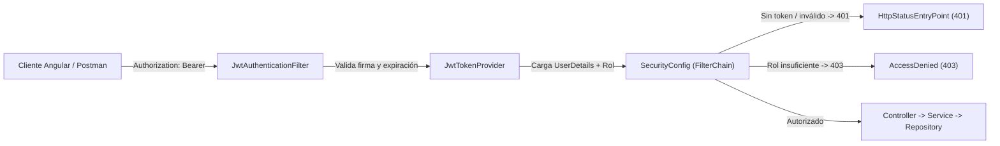

# ARCHITECTURE.md — Arquitectura de Seguridad, Identidad y Redes (COMPUNEX B2B)

> **Área Técnica:** Seguridad y Redes  
> **Fase del SDLC:** Fase 02 · Diseño y Arquitectura

---

## 🏛️ 1. Definición de la Arquitectura de Seguridad

* **Modelo de Autenticación:** **JWT Bearer Stateless** (`io.jsonwebtoken:jjwt 0.12.6`) sin sesiones en servidor (`SessionCreationPolicy.STATELESS`).
* **Hashing de Contraseñas:** `BCryptPasswordEncoder` (`SecurityConfig`).
* **Modelo de Autorización:** **RBAC por Roles** (`ROLE_COMPRADOR`, `ROLE_PROVEEDOR`, `ROLE_ADMIN`) + validación de propiedad del recurso en capa de servicio (`RN-001`, `RN-007`).
* **Política CORS:** Configurada en `SecurityConfig` permitiendo métodos `GET`, `POST`, `PUT`, `PATCH`, `DELETE`, `OPTIONS` para integración con el cliente Angular.

---

## 🧱 2. Flujo de Autenticación y Fronteras de Confianza

---

## 🔐 3. Matriz de Control de Acceso por Ruta (`SecurityConfig.java`)

| Patrón de Ruta | Método HTTP | Acceso / Rol Requerido | Respuesta sin Autorización |
| :--- | :---: | :--- | :---: |
| `/api/v1/auth/login`, `/api/v1/auth/register`, `/api/v1/auth/registro-proveedor`, `/api/v1/auth/register-company` *(Nuevo)* | `POST` | Público (`permitAll`) | — |
| `/api/v1/categories`, `/api/v1/categories/**` | `GET` | Público (`permitAll`) | — |
| `/api/v1/products`, `/api/v1/products/**` *(Nuevo)* | `GET` | Público (`permitAll`) | — |
| `/swagger-ui/**`, `/swagger-ui.html`, `/api-docs/**`, `/v3/api-docs/**` | `GET` | Público (`permitAll`) | — |
| `/api/v1/auth/me`, `/api/v1/auth/password` | `GET` / `PATCH` | Cualquier usuario autenticado | `401 Unauthorized` |
| `/api/v1/providers/me/activate` *(Nuevo — declarar antes de `/providers/**`)* | `POST` | Cualquier usuario autenticado | `401 Unauthorized` |
| `/api/v1/orders/**` *(Nuevo)* | `GET` / `POST` | Cualquier usuario autenticado | `401 Unauthorized` |
| `/api/v1/providers/me/products/**`, `/api/v1/providers/me/profile` *(Nuevo)*, `/api/v1/providers/me/sales/**` *(Nuevo)* | Todos | `ROLE_PROVEEDOR` | `401` / `403 Forbidden` |
| `/api/v1/admin/**` | Todos | `ROLE_ADMIN` | `401` / `403 Forbidden` |

---

## ⚠️ 4. Regla de Gestión de Secretos (Pendiente de Cierre `DT-01`)

* Actualmente `application.properties` contiene `jwt.secret` y credenciales de base de datos en texto plano.
* Para cumplir `RNF-003`, deben externalizarse en `application-dev.properties` y `application-prod.properties` usando `${JWT_SECRET}`, `${DB_URL}`, `${DB_USER}` y `${DB_PASS}`.
