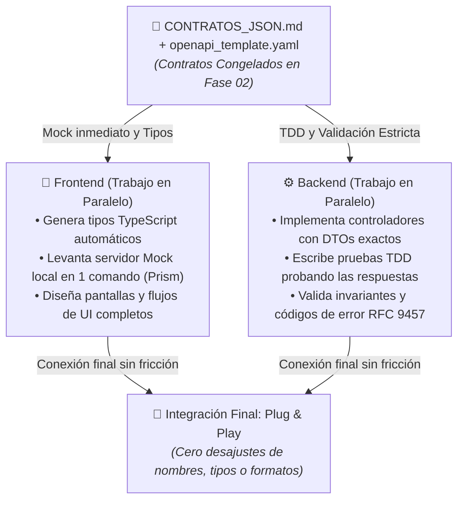

# Integración e Interfaces (APIs y Contratos)

**Fase:** 02. Diseño y Arquitectura.

> **Propósito del Área:** Acordar con precisión matemática cómo se comunican cliente y servidor, congelando las especificaciones de datos JSON antes de que nadie escriba código.

---

## 📄 Artefactos Canónicos de Contratos en esta Carpeta

Para evitar la desincronización entre frontend y backend, esta área utiliza **2 artefactos canónicos complementarios** siguiendo los estándares oficiales de la industria:

| Artefacto Canónico | Formato / Estándar | Propósito y Contenido |
| :--- | :--- | :--- |
| [`CONTRATOS_JSON.md`](CONTRATOS_JSON.md) | **Markdown narrativo + JSON Schema** · Estándares IETF RFC 9457 / RFC 4122 | **Contrato Maestro de Datos:** Define las convenciones universales (nombres `snake_case`, IDs UUID v4, marcas de tiempo ISO-8601 UTC), política de idempotencia (`Idempotency-Key`), catálogo unificado de errores y clasificación de operaciones (online vs offline). |
| [`openapi_template.yaml`](openapi_template.yaml) | **OpenAPI 3.1.0 (YAML)** · OpenAPI Initiative / Linux Foundation | **Especificación Ejecutable Formal:** Define rutas (`/v1/...`), verbos HTTP, esquemas de entrada/salida y códigos de estado. Permite generar mocks inmediatos (Prism) y clientes tipados (TypeScript / DTOs). |
| [`ARCHITECTURE.md`](ARCHITECTURE.md) | **Markdown Arquitectónico** | Arquitectura de comunicación (síncrona REST, asíncrona por eventos, WebSockets). |

---

### 🚀 Desacoplamiento y Desarrollo en Paralelo (Contract-First)

---

## Qué se hace

1. Identificar operaciones, consumidores, proveedor y fuente canónica del contrato.
2. Especificar tipos, unidades, nulos, permisos y errores; completar semántica de tiempo, orden o reintento cuando aplique.
3. Definir versionado, compatibilidad y comprobaciones de ambos extremos.

## Qué no se hace

- No limitar todos los contratos a HTTP ni asumir que un esquema prueba integración real.
- No cambiar semántica acordada sin analizar consumidores.

## Qué aplicar según el caso

| Necesidad | Opción o práctica | Decisiones y costes |
|---|---|---|
| Acordar interfaz antes de construir | CDD / contract-first | Una fuente del esquema y semántica, con responsables y versión |
| Pedir una respuesta inmediata | Interfaz síncrona | Timeouts, errores y dependencia de disponibilidad del proveedor |
| Exponer recursos HTTP | API orientada a recursos | Operaciones, entrada/salida, permisos y códigos de respuesta consistentes |
| Notificar un hecho a otras partes | Eventos asíncronos | Entrega, duplicados, orden, consistencia y tratamiento de fallos |
| Repartir trabajo dentro de un proceso | Contrato interno entre módulos | Dependencias permitidas y propiedad de los datos, sin añadir red innecesaria |
| Acordar expectativas verificables | BDD y contratos de consumidor cuando se elijan | Escenarios y controles de ambos extremos, además de integración real |

Los eventos desacoplan el momento de procesamiento, pero añaden decisiones de entrega y consistencia. [Microsoft: arquitectura orientada a eventos](https://learn.microsoft.com/en-us/azure/architecture/guide/architecture-styles/event-driven). La elección de HTTP y representación de recursos puede apoyarse en [su guía de API](https://learn.microsoft.com/en-us/azure/architecture/best-practices/api-design); no obliga a usar ese protocolo en todas las fronteras.

## Ejemplo didáctico ilustrativo (Plantilla de Operación HTTP e Idempotencia)

> [!IMPORTANT]
> **AVISO DE NEUTRALIDAD Y PLANTILLA (NO VINCULANTE):**  
> La siguiente operación HTTP es **estrictamente un ejemplo didáctico e ilustrativo**. **No debe tomarse en serio ni como una especificación impuesta.** No representa ningún proyecto real. **El usuario y su equipo deciden libremente los endpoints, métodos y esquemas en sus contratos (`CONTRATOS_JSON.md`, `openapi_template.yaml`).**

Se propone una operación HTTP puramente a modo de referencia didáctica:

| Parte del contrato | Propuesta del ejemplo (Didáctico) |
|---|---|
| Operación | `POST /v1/[recursos]` |
| Entrada | Identificador del recurso; la identidad del actor se obtiene del mecanismo autenticado (token) |
| Resultado satisfactorio | `201 Created`, identificador generado en UUID v4 y marcas de tiempo ISO-8601 |
| Conflicto de negocio | `409 Conflict` (Problem Details RFC 9457) cuando se viola una invariante de dominio |
| Permiso insuficiente | `403 Forbidden` definido por la política de autorización, sin modificar datos |
| Reintento | Cabecera `Idempotency-Key` para evitar efectos duplicados ante reintentos de red |
| Compatibilidad | Campos y reglas de evolución versionados en una fuente canónica (`openapi_template.yaml`) |

POST no es idempotente por sí mismo: la política de reintento se diseña y verifica como parte del contrato. [RFC 9110: métodos idempotentes](https://www.rfc-editor.org/rfc/rfc9110.html#section-9.2.2). El servidor protege la unicidad de las transacciones incluso ante solicitudes concurrentes.

Si un consumidor procesa un evento asíncrono «[Recurso Creado]», el contrato del evento identifica versión, tipo de evento, identificador y momento. Diseñar cómo se relaciona su publicación con la confirmación de datos y cómo se detectan duplicados; recibir dos veces el mismo hecho no debe generar un efecto de negocio duplicado si esa es la garantía acordada.

### Escenarios a preparar

- Solicitud válida y respuesta satisfactoria (`201`).
- Recurso no disponible o regla violada (`409`).
- Pérdida de respuesta y reintento con `Idempotency-Key`.
- Consumidor con una versión compatible y fallo del proveedor.

Los códigos y campos son decisiones del ejemplo, no un esquema universal. Los escenarios se enlazan al contrato y después a sus pruebas y resultados.

## Plantilla de trabajo

Completar en el documento del proyecto o enlazar la fuente donde ya conste la decisión. Usar solo los campos pertinentes y justificar lo no aplicable; conservar hechos, hipótesis y decisiones diferenciados.

| Campo | Contenido o referencia del proyecto |
|---|---|
| Operación, consumidor y proveedor | |
| Entrada/salida y restricciones | |
| Permisos y errores | |
| Idempotencia, concurrencia y tiempos pertinentes | |
| Versión, compatibilidad y comprobaciones | |

## Recursos para aplicar el área

**Skills:** [cdd-contract-driven](../../../02_Skills/02_Arquitectura_e_Integracion/cdd-contract-driven/SKILL.md) · [bdd](../../../02_Skills/01_Generales/bdd/SKILL.md).

**Plantillas canónicas, cuando se elija el método:**

- [contrato_integracion_template.md](../../../02_Skills/02_Arquitectura_e_Integracion/cdd-contract-driven/assets/plantillas/contrato_integracion_template.md)

## Resultado y comprobación

Contrato versionado, responsables y estrategia de integración. Vincular decisiones y controles con su evidencia real y declarar lo pendiente.

[README de la fase](../README.md) · [Índice del ciclo](../../README.md).
