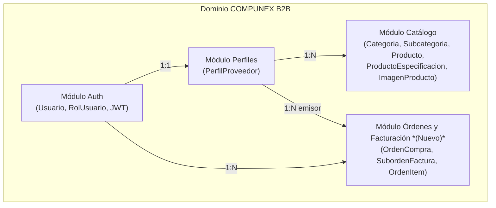

# DOMAIN.md — Modelo de Dominio, Lenguaje Ubicuo y Reglas de Negocio (COMPUNEX B2B)

> **Fase del SDLC:** Fase 02 · Diseño y Arquitectura  
> **Propósito:** Fuente única de verdad del dominio de negocio mayorista de hardware para mantener coherencia entre Back-end (`compunex-backend`), Base de Datos y Front-end (Angular).

---

## 📖 1. Glosario y Lenguaje Ubicuo (Ubiquitous Language)

| Término de Negocio | Definición | Nombre en Código (Java) | Nombre en Base de Datos | Nombre visible en UI |
| :--- | :--- | :--- | :--- | :--- |
| **Usuario** | Cuenta autenticada en la plataforma con credenciales, estado y rol. | `Usuario` | `usuarios` | "Usuario" / "Cuenta" |
| **Rol de Usuario** | Nivel de permisos asignado a una cuenta (`PROVEEDOR`, `ADMIN`). | `RolUsuario` | `rol` | "Rol" |
| **Estado de Usuario** | Situación operativa de la cuenta (`ACTIVO`, etc.). | `EstadoUsuario` | `estado` | "Estado de cuenta" |
| **Perfil de Proveedor** | Ficha comercial y fiscal (RUC/ID fiscal, razón social, dirección, ciudad) vinculada 1:1 a un usuario proveedor. | `PerfilProveedor` | `perfiles_proveedor` | "Perfil de Proveedor" |
| **Categoría** | Agrupación principal de hardware mayorista con identificador textual, icono y conteo de productos. | `Categoria` | `categorias` | "Categoría" |
| **Subcategoría** | Clasificación técnica hija perteneciente a una categoría. | `Subcategoria` | `subcategorias` | "Subcategoría" |
| **Producto** | Artículo mayorista publicado por un proveedor con formato comercial, precios referenciales, especificaciones e imágenes. | `Producto` | `productos` | "Producto" |
| **Modelo Comercial** | Modalidad de venta mayorista del producto (`ModeloComercial`). | `ModeloComercial` | `modelo_comercial` | "Modelo comercial" |
| **Estado de Producto** | Estado del ciclo de vida del producto (`ACTIVO`, etc.). | `EstadoProducto` | `estado` | "Estado" |
| **Especificación Técnica** | Par clave-valor que describe una característica técnica del producto. | `ProductoEspecificacion` | `producto_especificaciones` | "Especificaciones técnicas" |
| **Imagen de Producto** | Recurso visual ordenado asociado a un producto. | `ImagenProducto` | `imagenes_producto` | "Galería / Imágenes" |
| **Orden de Compra** *(Nuevo)* | Transacción global iniciada por un comprador en un checkout único. | `OrdenCompra` | `ordenes` | "Pedido / Compra" |
| **Suborden / Factura Simulada** *(Nuevo)* | Comprobante B2B emitido por un proveedor específico dentro de una orden de compra. | `SubordenFactura` | `subordenes_factura` | "Comprobante / Factura" |
| **Ítem de Orden** *(Nuevo)* | Línea de detalle con producto, cantidad mayorista y precio unitario congelado al comprar. | `OrdenItem` | `orden_items` | "Detalle de producto" |

---

## 🔤 2. Convenciones de Nomenclatura entre Capas

| Elemento | Convención Formal en el Proyecto | Ejemplo Real en `compunex-backend` |
| :--- | :--- | :--- |
| **Paquetes Java (Back-end)** | `camelCase` por módulos y capas | `com.compunex.b2b.modules.catalogo.controller` |
| **Clases y Entidades** | `PascalCase`, singular | `Producto`, `PerfilProveedor`, `Categoria` |
| **Tablas de Base de Datos** | `snake_case`, plural | `usuarios`, `perfiles_proveedor`, `productos`, `imagenes_producto` |
| **Columnas en BD** | `snake_case` | `identificacion_fiscal`, `precio_unitario_ref`, `fecha_eliminacion` |
| **Rutas / Endpoints API** | Versionado `/api/v1/...` en `kebab-case` | `/api/v1/providers/me/products`, `/api/v1/categories` |
| **Carpetas Front-end (Angular)** | `kebab-case` por *features* | `product-list`, `product-form`, `not-found` |

---

## ⚖️ 3. Invariantes y Reglas de Negocio (RN)

| Código | Enunciado de la Regla | Afirmación Verificable | Dónde se Prueba (TDD) |
| :---: | :--- | :--- | :--- |
| **RN-001** | **Propiedad estricta del catálogo (Proveedor):** Un proveedor solo puede consultar en detalle, editar, cambiar estado o eliminar sus propios productos. | Toda operación en `/api/v1/providers/me/products/**` filtra o valida que `producto.proveedor.usuario` corresponda al usuario autenticado. | `ProductoServiceTest` / `ProductoProveedorControllerTest` |
| **RN-002** | **Registro atómico de proveedor:** El alta de un proveedor crea simultáneamente su `Usuario` (`RolUsuario.PROVEEDOR`) y su `PerfilProveedor` bajo transacción única. | Si falla la validación fiscal o de correo único, no queda ningún registro huérfano (`@Transactional`). | `AuthServiceTest` |
| **RN-003** | **Validación previa al cambio de contraseña:** Ningún usuario puede actualizar su contraseña sin confirmar correctamente la contraseña actual. | Si `BCrypt.matches` falla contra `hashContrasena`, se lanza `ContrasenaActualIncorrectaException` (`400 Bad Request`). | `AuthServiceTest` |
| **RN-004** | **Borrado lógico (Soft Delete):** La eliminación de un producto por el proveedor no borra la fila física; registra `fechaEliminacion` y `eliminadoPor`. | Los listados del proveedor excluyen productos con `fechaEliminacion != null`. | `ProductoServiceTest` / `ProductoRepositoryTest` |
| **RN-005** | **Administración de plataforma:** Funciones y permisos del administrador pendientes de definición. La gestión del estado de cada producto corresponde a su proveedor (RN-001). | Pendiente de definir. | Pendiente de definir. |
| **RN-006** | **Composición en cascada de producto:** Las especificaciones técnicas e imágenes pertenecen al ciclo de vida del `Producto` (`CascadeType.ALL`, `orphanRemoval = true`). | Al crear o actualizar un producto, sus listas hijas se sincronizan atómicamente con el producto padre. | `ProductoServiceTest` |
| **RN-007** | **Prohibición de auto-compra *(Nuevo)*:** Un usuario proveedor no puede comprar productos publicados por su propio `PerfilProveedor`. | Si `producto.proveedor.usuario.id == comprador.id`, el checkout rechaza la operación con `400 Bad Request`. | `OrdenServiceTest` |
| **RN-008** | **División por proveedor y cálculo fiscal *(Nuevo)*:** Todo checkout agrupa ítems por `proveedor_id`, genera 1 `SubordenFactura` por proveedor y calcula `subtotal`, `igv (18%)` y `total` en el servidor. | Los precios e importes se calculan desde BD en el Back-end, nunca confiando en totales enviados por el cliente. | `OrdenServiceTest` |

---

## 🧩 4. Bounded Contexts (Límites del Dominio)

