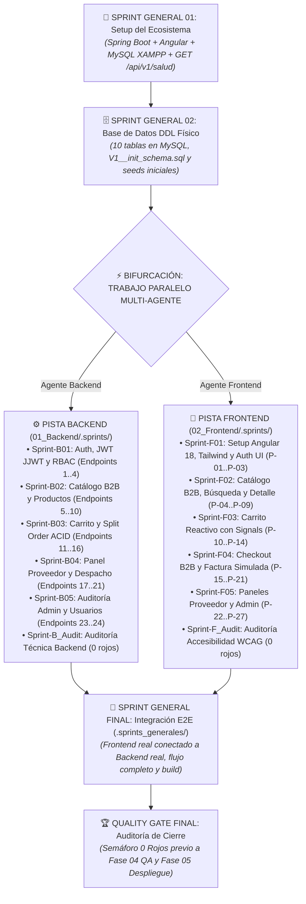

# 03. Construcción y Desarrollo Local (SDD + TDD + Multi-Agente en Paralelo)

> **Fase del SDLC:** Fase 03 · Construcción y Desarrollo  
> **Proyecto:** COMPUNEX — Plataforma E-Commerce B2B con Split Order y Facturación Simulada  
> **Arquitectura Operativa:** **Multi-Agente Concurrente Desacoplada**  
> **Stack Congelado:** Java 17 + Spring Boot 3.2.0 + MySQL 8.0 (XAMPP 3306) · Angular 18 (Standalone, Signals) + SASS + Tailwind CSS  
> **Regla de Oro:** **Cero líneas de código sin un SPEC aprobado.** El Frontend y el Backend avanzan en paralelo de forma 100% desacoplada gracias a los contratos congelados de Fase 02 (`CONTRATOS_JSON.md`).

---

## 🎯 1. ¿Cuál es el Objetivo Central de esta Organización por Áreas?

El objetivo primordial de dividir los sprints en áreas especializadas (`.sprints_generales/`, `01_Backend/.sprints/`, `02_Frontend/.sprints/`) es permitir el **TRABAJO PARALELO CON MÚLTIPLES AGENTES DE IA (O DESARROLLADORES) SIN CUELLOS DE BOTELLA**:

1. **Desacoplamiento Absoluto (Contract-First):**  
   Al culminar la Fase 02, los contratos de API ([`CONTRATOS_JSON.md`](../02_Fase_Diseno_y_Arquitectura/05_Integracion_y_APIs/CONTRATOS_JSON.md)) y el modelo de BD ya están **100% formalizados y congelados**.  
   Por tanto, **EL AGENTE DE FRONTEND NO TIENE QUE ESPERAR A QUE EL BACKEND ESTÉ TERMINADO**: trabaja contra el Mock Server de la API con los mismos contratos.
2. **Pistas de Trabajo Autónomas:**  
   * **Agente de Backend:** Opera en [`01_Backend/`](01_Backend/README.md), guiado por su propio backlog ([`BACKLOG_BACKEND.md`](01_Backend/BACKLOG_BACKEND.md)), su bitácora ([`MEMORY_BACKEND.md`](01_Backend/MEMORY_BACKEND.md)), y sus sprints en `01_Backend/.sprints/` (`Sprint-B01` a `Sprint-B05` + `Sprint-B_Audit`). Construye lógica pura y endpoints contra MySQL en XAMPP.
   * **Agente de Frontend:** Opera simultáneamente en [`02_Frontend/`](02_Frontend/README.md), guiado por su propio backlog ([`BACKLOG_FRONTEND.md`](02_Frontend/BACKLOG_FRONTEND.md)), su bitácora ([`MEMORY_FRONTEND.md`](02_Frontend/MEMORY_FRONTEND.md)), y sus sprints en `02_Frontend/.sprints/` (`Sprint-F01` a `Sprint-F05` + `Sprint-F_Audit`). Construye vistas, signals y componentes contra el mock server.
   * **Sprints Generales Transversales (`.sprints_generales/`):**
     - `Sprint-G01_Setup_y_Entorno`: Arranque común de herramientas y variables.
     - `Sprint-G02_Base_de_Datos_DDL`: Persistencia física y semillas iniciales.
     - `Sprint-G_Final_Integracion_E2E`: Punto de convergencia donde se apaga el mock, se conecta el Frontend al Backend real, se ejecutan smoke tests de punta a punta y se audita el release.
3. **Orquestación Macro sin Conflictos:**  
   [`BACKLOG_GENERAL.md`](BACKLOG_GENERAL.md) y [`MEMORY_GENERAL.md`](MEMORY_GENERAL.md) coordinan a los agentes desde la raíz de la fase sin colisiones de Git.

---

## 🗺️ 2. Flujo Cronológico de Construcción Multi-Agente

---

## 🚫 3. Regla de Oro Anti-Placeholder

> [!CAUTION]
> **PROHIBICIÓN ESTRICTA:**  
> Ninguna pista contiene carpetas `_Plantilla` ni un solo sprint aislado.  
> * **Backend:** Cuenta con sus **5 sprints funcionales** + **1 sprint de auditoría** cubriendo los 24 endpoints.
> * **Frontend:** Cuenta con sus **5 sprints de UI** + **1 sprint de auditoría** cubriendo las 27 pantallas.
> * **Generales:** Cuenta con los **3 sprints transversales** de inicio y cierre.

---

## 📁 4. Mapa de Carpetas de la Fase

| Directorio / Archivo | Rol en el Proyecto |
| :--- | :--- |
| [`BACKLOG_GENERAL.md`](BACKLOG_GENERAL.md) | **Tablero Macro:** Visión global de hitos, dependencias entre áreas y control de avance. |
| [`MEMORY_GENERAL.md`](MEMORY_GENERAL.md) | **Bitácora Macro:** Registro del estado del sistema general y resultados de Quality Gates. |
| [`SPEC_TEMPLATE.md`](SPEC_TEMPLATE.md) | **Plantilla SDD:** Estructura oficial Given-When-Then para instanciar cualquier sprint. |
| [`AUDITORIA_HITO_TEMPLATE.md`](AUDITORIA_HITO_TEMPLATE.md) | **Plantilla Quality Gate:** Formato oficial con semáforo (Rojos / Ámbares / Verdes). |
| [`.sprints_generales/`](.sprints_generales/README.md) | **Sprints Transversales:** Setup inicial (`G01`), Persistencia DDL (`G02`) e Integración E2E (`G_Final`). |
| [`01_Backend/`](01_Backend/README.md) | **Pista Backend:** Normas de ingeniería, [`BACKLOG_BACKEND.md`](01_Backend/BACKLOG_BACKEND.md), [`MEMORY_BACKEND.md`](01_Backend/MEMORY_BACKEND.md) y sus sprints (`.sprints/Sprint-B01..`). |
| [`02_Frontend/`](02_Frontend/README.md) | **Pista Frontend:** Normas de UI, [`BACKLOG_FRONTEND.md`](02_Frontend/BACKLOG_FRONTEND.md), [`MEMORY_FRONTEND.md`](02_Frontend/MEMORY_FRONTEND.md) y sus sprints (`.sprints/Sprint-F01..`). |
| [`03_Datos_y_Migraciones/`](03_Datos_y_Migraciones/README.md) | **Persistencia Física:** DDL puro de 10 tablas, migraciones Flyway y datos semilla en MySQL. |
| [`04_Integracion_y_Configuracion/`](04_Integracion_y_Configuracion/README.md) | **Configuración:** Variables `.env.example`, colección Postman automatizada y proxy local. |

---

[← Volver a Fase 02: Diseño y Arquitectura](../02_Fase_Diseno_y_Arquitectura/README.md) · [Ir al Backlog General →](BACKLOG_GENERAL.md)
