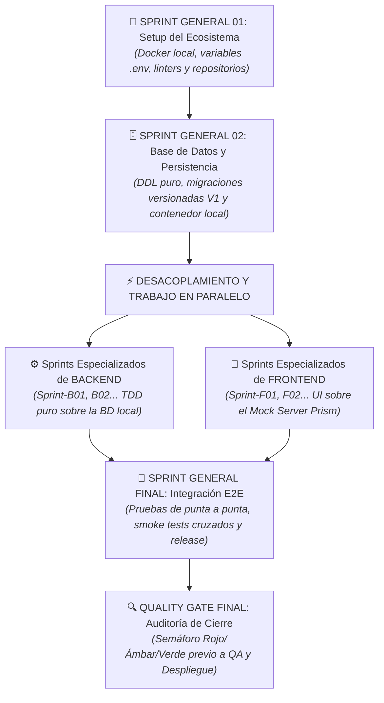
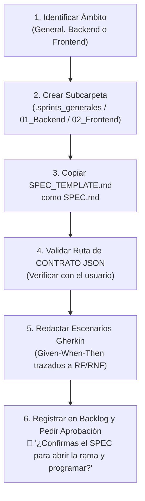

# 03. Construcción y Desarrollo Local (SDD + TDD + Multi-Agente)

> **Fase del SDLC:** Fase 03 · Construcción y Desarrollo  
> **Propósito:** Transformar los requisitos validados de la Fase 01 y los diseños/contratos congelados de la Fase 02 en código de producción probado, limpio y mantenible mediante Desarrollo Guiado por Especificaciones (SDD) y Desarrollo Guiado por Pruebas (TDD).  
> **Regla de Oro:** Respetar el SPEC y las políticas de pruebas que el proyecto haya adoptado; adaptar la evidencia al riesgo.

---

## 🏛️ 1. Arquitectura de Construcción Multi-Agente y Descentralizada

Para evitar cuellos de botella y permitir trabajo coordinado por agentes o desarrolladores cuando las dependencias lo permitan:

* **Sprints Generales (`.sprints_generales/`):** Tareas transversales del sistema (Setup del entorno, base de datos DDL inicial, integración E2E).
* **Sprints Especializados de Backend (`01_Backend/.sprints/`):** Construcción autónoma de lógica de negocio, servicios puros desacoplados y endpoints contra contratos congelados.
* **Sprints Especializados de Frontend (`02_Frontend/.sprints/`):** Construcción autónoma de interfaces visuales, estado reactivo y navegación contra el Mock Server de la API.
* **Contrato compartido:** Frontend y backend respetan el contrato acordado y registran sus cambios. Las siguientes rutas son ejemplos de plantillas: [`CONTRATOS_JSON.md`](../02_Fase_Diseno_y_Arquitectura/05_Integracion_y_APIs/CONTRATOS_JSON.md) y [`openapi_template.yaml`](../02_Fase_Diseno_y_Arquitectura/05_Integracion_y_APIs/openapi_template.yaml).

---

## 🗺️ 2. Flujo Cronológico de Construcción

---

## 🔄 3. Ciclo de Ejecución de un Sprint (Micro-Ciclo TDD)

Cuando el proyecto adopte sprints y SPEC, adapta este ciclo al riesgo y al incremento:

1. **Lectura y Contexto:** Leer la bitácora (`MEMORY.md` del área) y el contrato del sprint (`SPEC.md`).
2. **Planificación (`/plan` - Modelo Alto Razonamiento):** Detectar dependencias o posibles incoherencias con `DOMAIN.md` antes de tocar código.
3. **Rojo (TDD - Modelo Estándar):** Escribir primero las pruebas automatizadas basadas en los escenarios `Given-When-Then` del SPEC. Demostrar que fallan en local.
4. **Verde (TDD - Modelo Estándar):** Escribir el código mínimo de producción necesario para pasar las pruebas. Prohibido añadir lógica fuera del SPEC.
5. **Refactorización y Validación:** Limpiar el código manteniendo la suite de pruebas al 100% en verde. Verificar reglas de capas y linters.
6. **Cierre del Sprint:** Actualizar la bitácora del área, marcar el sprint como `Done` en el backlog y hacer commit en Git.
7. **Reporte al PO:** Presentar evidencia demostrable y continuar según las autorizaciones vigentes y las reglas del proyecto.

---

## 📁 4. Mapa de Carpetas y Artefactos de la Fase

| Directorio / Archivo | Propósito y Contenido |
| :--- | :--- |
| [`BACKLOG_GENERAL.md`](BACKLOG_GENERAL.md) | Tablero macro de control de hitos y sprints para el Product Owner y Tech Leads. |
| [`MEMORY_GENERAL.md`](MEMORY_GENERAL.md) | Bitácora viva del sistema transversal y registro de Quality Gates generales. |
| [`SPEC_TEMPLATE.md`](SPEC_TEMPLATE.md) | Plantilla oficial SDD con sintaxis Given-When-Then para cualquier sprint. |
| [`AUDITORIA_HITO_TEMPLATE.md`](AUDITORIA_HITO_TEMPLATE.md) | Plantilla canónica de Quality Gate con semáforo (Rojo / Ámbar / Verde). |
| [`.sprints_generales/`](.sprints_generales/README.md) | Sprints transversales: Setup inicial, Persistencia DDL e Integración E2E. |
| [`01_Backend/`](01_Backend/README.md) | Normas de construcción del backend, bitácora local (`MEMORY_BACKEND.md`) y sus sprints. |
| [`02_Frontend/`](02_Frontend/README.md) | Normas de construcción del frontend, bitácora local (`MEMORY_FRONTEND.md`) y sus sprints. |
| [`03_Datos_y_Migraciones/`](03_Datos_y_Migraciones/README.md) | Reglas de esquemas DDL puros, scripts versionados y migraciones. |
| [`04_Integracion_y_Configuracion/`](04_Integracion_y_Configuracion/README.md) | Docker Compose local, `.env.example`, clientes API y configuración CI. |

---

## 🌿 5. Integración con Git Flow

* Cada sprint se desarrolla en su propia rama dedicada:  
  `feature/<area>-<nombre-tarea>` (ej. `feature/backend-auth`, `feature/frontend-login`, `feature/datos-ddl`).
* Todas las ramas nacen de `develop` y regresan a `develop` mediante Pull Request tras cumplir el **Definition of Done (DoD)**.
* Los mensajes de commit se redactan en modo imperativo técnico, describiendo el qué y el porqué, **sin mención de asistentes de IA**.

---

## 🤖 6. Protocolo del Agente IA: Cómo Crear un Nuevo Sprint (Paso a Paso)

Todo agente de IA (Antigravity, Claude, Gemini, Cursor) debe seguir este procedimiento exacto para crear un nuevo sprint:

### Paso 1: Determinar el Ámbito y Nomenclatura de la Carpeta
* Si es transversal (entorno, DDL base, integración E2E):  
  Crear carpeta en `.sprints_generales/Sprint-G<NN>_<Nombre>/`
* Si es lógica de servidor, APIs o servicios:  
  Crear carpeta en `01_Backend/.sprints/Sprint-B<NN>_<Nombre>/`
* Si es pantalla, interfaz de usuario o navegación:  
  Crear carpeta en `02_Frontend/.sprints/Sprint-F<NN>_<Nombre>/`

### Paso 2: Instanciar el SPEC.md
* Copiar el archivo [`SPEC_TEMPLATE.md`](SPEC_TEMPLATE.md) dentro de la carpeta creada y nombrarlo exactamente `SPEC.md`.

### Paso 3: Rellenar la Especificación sin Omitir Campos
1. **Objetivo:** 1 o 2 frases del valor demostrable del incremento.
2. **Alcance:** Qué requisitos de la Fase 01 se construyen y cuáles quedan explícitamente fuera.
3. **Escenarios Given-When-Then (`E1`, `E2`, `E3`...):** Los casos exactos que se probarán en TDD (Happy Path, validaciones y reglas de negocio).
4. **Tareas:** Diferenciar las manuales (del usuario/PO) de las automáticas (del agente).
5. **DoD:** Criterios de cierre y tests en verde.

### Paso 4: Registrar en el Backlog
* Añadir la fila correspondiente en [`BACKLOG_GENERAL.md`](BACKLOG_GENERAL.md) (y en el backlog del área si aplica) con estado `⬜ Pendiente`.

### Paso 5: Revisión y autorización
Reutiliza decisiones y aprobaciones ya otorgadas. Presenta el SPEC cuando el proyecto lo requiera o una decisión de alcance necesite aprobación. Una vez autorizado el incremento, ejecuta las tareas independientes sin volver a preguntar.

## 7. Contratos de integración
Busca el contrato vigente del proyecto y verifica su versión y alcance. Si falta o hay varias fuentes incompatibles, documenta la discrepancia y consulta solo lo que impida avanzar. Las plantillas [narrativa](../02_Fase_Diseno_y_Arquitectura/05_Integracion_y_APIs/CONTRATOS_JSON.md) y [OpenAPI](../02_Fase_Diseno_y_Arquitectura/05_Integracion_y_APIs/openapi_template.yaml) son ejemplos, no contratos del producto hasta que se adopten y completen.

Un mock ayuda a desarrollar, pero no garantiza compatibilidad real ni simula necesariamente estado, permisos y errores. Verifica el proveedor real cuando sea viable y deja explícitas las limitaciones.

## 8. Equipo y trabajo paralelo
Utiliza [EQUIPO_Y_CRONOGRAMA_TEMPLATE.md](EQUIPO_Y_CRONOGRAMA_TEMPLATE.md) cuando aporte valor. Antes de paralelizar, define responsables, archivos, dependencias, contrato y puntos de integración; respeta las restricciones de delegación y permisos vigentes. Resuelve conflictos y ejecuta pruebas cruzadas con frecuencia.

## 9. Integración y revisión
Adopta el flujo Git y las políticas de revisión del proyecto. Define el momento de integración y despliegue por riesgo y por funcionalidad preparada; no prometas frecuencia fija. La revisión humana se realiza cuando la exige el proyecto o la naturaleza de la decisión; los commits y despliegues respetan las autorizaciones del usuario. Los controles manuales, herramientas y dispositivos dependen del cambio y de la evidencia disponible.
