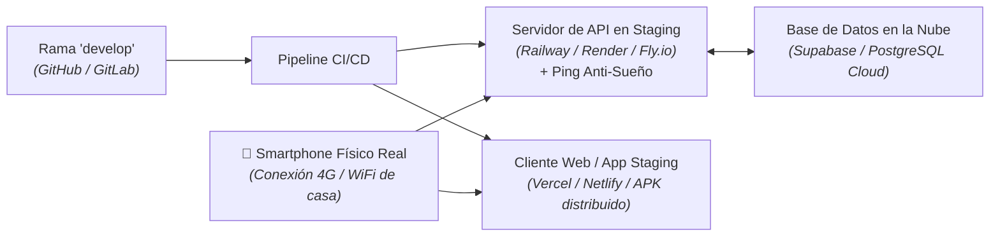

# 06. Validación en Staging y Pre-Producción en Nube

> **Área Técnica:** DevOps, QA & Cloud Testing  
> **Fase del SDLC:** Fase 04 · Pruebas y Validación Local  
> **Propósito:** Validar el comportamiento del software en un entorno real en la nube (**Pre-Producción / Staging**) desplegado automáticamente desde la rama `develop`, utilizando dispositivos físicos reales y redes móviles antes de autorizar el pase a Producción.

---

## ☁️ 1. ¿Por qué validar en Staging cada 2 o 3 Sprints?

En la máquina local (`localhost`), muchas condiciones de red no existen:
* En local no hay latencia real de red móvil (3G/4G/5G).
* En local no hay bloqueos de CORS entre dominios distintos.
* En local no hay certificados SSL/TLS (HTTPS estricto).
* En local no se puede comprobar si un webhook externo (ej. pasarela de pagos) llega correctamente a la URL pública del servidor.

> 💡 **La Regla de Pre-Producción:**  
> Cada 2 a 3 sprints, cuando se completa un flujo funcional de negocio en local, se realiza merge hacia `develop`.  
> El entorno de Staging (preparado con antelación por el rol de DevOps/QA) se actualiza de forma automática y permite al equipo probar el software **en la vida real**.

---

## 🛠️ 2. Arquitectura del Entorno de Staging (Ejemplo Canónico)

---

## 📱 3. Protocolo de Pruebas en Dispositivos Reales

El equipo (en especial el QA y el Product Owner) debe ejecutar las siguientes comprobaciones desde un **dispositivo móvil físico**:

### 3.1 Pruebas de Red y Conectividad
* [ ] **Carga bajo red móvil (4G/5G):** Abrir la aplicación sin conexión WiFi. Comprobar que las pantallas carguen en un tiempo aceptable (< 2 segundos).
* [ ] **Prueba de Modo Avión (Offline-First):** Activar el modo avión en el celular. Comprobar que la aplicación muestre el banner *"Modo sin conexión"* y permita consultar datos cacheados sin cerrarse inesperadamente (cero crash).
* [ ] **Reconexión:** Desactivar el modo avión y comprobar que los datos pendientes se sincronicen con Supabase en la nube.

### 3.2 Pruebas de Ergonomía Táctil y Pantalla
* [ ] **Áreas táctiles en pantalla pequeña:** Presionar botones principales con el pulgar. Comprobar que no se toquen accidentalmente elementos adyacentes (mínimo 48 dp).
* [ ] **Teclado virtual:** Enfocar inputs en formularios. Comprobar que el teclado virtual del celular no tape el botón de acción principal ni rompa el scroll.

### 3.3 Integración con Terceros (Webhooks y Pasarelas)
* [ ] **Pasarelas de Pago / Webhooks:** Ejecutar una transacción en modo sandbox. Comprobar que la URL pública de Railway reciba el evento y actualice el estado en Supabase.
* [ ] **Notificaciones o Emails de Prueba:** Comprobar que los correos transaccionales lleguen a la bandeja de entrada real.

---

## 📋 4. Lista de Chequeo de Cierre de Staging

Antes de autorizar el merge de `develop` a `main`:

* [ ] La URL de Staging responde con estado `200 OK` en `GET /v1/salud`.
* [ ] El *ping anti-sueño* está activo evitando que la instancia duerma.
* [ ] Ningún error `500` registrado en los logs del servidor de Railway durante la sesión de pruebas.
* [ ] El flujo funcional completo fue probado y aprobado por el Product Owner en su propio teléfono o navegador.
