# BACKLOG_QA.md — Product Backlog Autónomo de Pruebas y Validación

> **Área Técnica:** Quality Assurance (QA) & Validación de Producto  
> **Fase del SDLC:** Fase 04 · Pruebas y Validación Local  
> **Propósito:** Gestión de los sprints de verificación y calidad del software antes de autorizar el pase a Despliegue en Producción (Fase 05).  
> **Regla de Operación:** Cada sprint de QA desglosa explícitamente las **Tareas Humanas (Manuales)** de las **Tareas del Agente de IA (Automatizadas)**.

---

## 📊 1. Resumen y Parámetros Operativos de QA

| Parámetro | Definición del Proyecto |
| :--- | :--- |
| **Objetivo de la Fase** | Validar la integración real, verificar requisitos de negocio (`RF-XXX`), atributos de calidad (`RNF-XXX`) y auditar Staging. |
| **Responsables** | `[QA Lead / Product Owner / Desarrolladores / Agente de IA]` |
| **Mecanismo de Ejecución** | Híbrido: Automatización masiva por la IA + Exploración, ergonomía y aprobación soberana por el humano. |
| **Criterio de Cierre (DoD)** | 100% tests en verde, 0 bugs críticos o altos abiertos, y semáforo en **VERDE** en `AUDITORIA_CALIDAD_FASE4_A_FASE5.md`. |

---

## 🏃 2. Matriz de Sprints de Pruebas y Validación

| ID Sprint | Épica / Tipo de Prueba | Responsable Principal | Tipo de Tareas | Criterios de Aceptación (DoD) | Estado |
| :---: | :--- | :---: | :---: | :--- | :---: |
| **Sprint-QA01** | Integración de APIs, Esquemas OpenAPI y RFC 9457 | Agente IA + Backend | 🤖 Automatizada + 👤 Humano | Fuzzing de contratos OpenAPI completado (`schemathesis`); respuestas RFC 9457 validadas en Postman; 0 discrepancias de tipos. | `[Pendiente]` |
| **Sprint-QA02** | Ergonomía UI y Accesibilidad WCAG 2.1 AA | Frontend Lead + Agente IA | 👤 Humano + 🤖 Automatizada | Escaneo axe-core en 0 violaciones críticas; prueba de áreas táctiles (48dp) y contraste (4.5:1) verificada por el humano. | `[Pendiente]` |
| **Sprint-QA03** | Escenarios E2E y Flujos Críticos de Negocio | QA Lead + Agente IA | 🤖 Automatizada + 👤 Humano | Suites E2E en Playwright/Cypress pasando al 100%; flujos de registro, catálogo y checkout aprobados por el Product Owner. | `[Pendiente]` |
| **Sprint-QA04** | Rendimiento, Carga Local y Seguridad SAST | Agente IA + DevOps | 🤖 Automatizada + 👤 Humano | Carga k6 con p95 < 200ms; escaneo `npm/pip audit` y `gitleaks` con 0 vulnerabilidades críticas o secretos expuestos. | `[Pendiente]` |
| **Sprint-QA05** | Validación en Staging y Smartphones Reales | Product Owner + Equipo | 👤 Humano Prioritario | Pruebas desde celular físico con 4G y modo avión; webhooks y pasarelas validadas en Railway/Supabase sin errores 500. | `[Pendiente]` |
| **Sprint-QA_Gate**| Auditoría de Calidad Final y Semáforo de Pase | PO + Tech Lead | 👤 Humano Soberano | Firma formal de `AUDITORIA_CALIDAD_FASE4_A_FASE5.md` en semáforo **VERDE**. Autorización de apertura de rama `release/*`. | `[Pendiente]` |

---

## 👥 3. Distribución de Responsabilidades: Humano vs Agente de IA

> [!IMPORTANT]
> **Principio de Complementariedad:** La IA destaca en velocidad, repetición y análisis de código; el humano aporta criterio de negocio, empatía, ergonomía real y la decisión final de aceptación.

```mermaid
flowchart LR
    subgraph TareasIA["🤖 Tareas del Agente de IA"]
        IA1["Generar suites de pruebas automatizadas (E2E / Integración)"]
        IA2["Ejecutar escaneos SAST y auditorías de dependencias"]
        IA3["Fuzzing de schemas OpenAPI y pruebas de carga k6"]
        IA4["Generar reportes y métricas de cobertura"]
    end

    subgraph TareasHumano["👤 Tareas del Desarrollador / PO"]
        H1["Probar en smartphone físico con clics reales y pulgar"]
        H2["Comprobar experiencia de usuario en red móvil 4G y modo avión"]
        H3["Validar en Postman casos de negocio complejos"]
        H4["Firma y autorización soberana del Quality Gate"]
    end

    TareasIA <-->|Colaboración Continua| TareasHumano
```

---

## 🚫 4. Fuera de Alcance Explícito de la Fase de QA

* **Reescritura de Arquitectura:** En QA no se cambia el estilo arquitectónico ni el modelo de datos acordado en Fase 02.
* **Adición de Nuevas Funcionalidades:** Si surge una nueva idea, se documenta en el backlog de producto para un incremento futuro; no se introduce en pleno testing.
* **Pruebas Destructivas en Producción:** Las pruebas de estrés y fallas se ejecutan exclusivamente en local y Staging.
