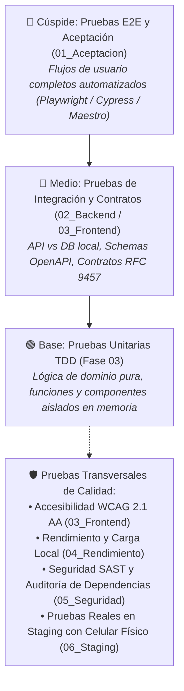

# 04. Pruebas y Validación Local (QA & Staging)

> **Adaptación neutral:** herramientas, proveedores, ramas, calendarios, valores y comandos de esta guía son ejemplos. Aplica solo los pertinentes y las decisiones aprobadas del proyecto; los resultados de un mock no certifican servicios reales. Ante conflicto, prevalecen [las reglas de gobernanza](../AGENTS.md).

> **Fase del SDLC:** Fase 04 · Pruebas y Validación Local  
> **Propósito:** Evaluar y validar la calidad integral del software construido, integrando las suites de pruebas automatizadas (pirámide de pruebas) y las comprobaciones en el entorno de Pre-Producción (Staging) antes de autorizar el paso a CI/CD y Despliegue en Producción (Fase 05).  
> **Regla de Oro:** **Aquí no empezamos a probar desde cero.** TDD ya validó la lógica en Fase 03. Esta fase emite el **veredicto del incremento**: integración entre partes, verificación de requisitos de negocio (`RF-XXX`), atributos de calidad (`RNF-XXX`) y validación en Staging.

---

## 🏛️ 1. Principios Rectores de la Fase de Pruebas

1. **Local-First para el Testing Automatizado:** Todas las suites unitarias, de integración y análisis estático deben poder ejecutarse al 100% en la máquina local (con base de datos Docker local).
2. **Validación Progresiva en Staging (Pre-Producción):** Cada 2 a 3 sprints, cuando se consolida un flujo completo, el software se despliega a Pre-Producción (Railway / Supabase) para realizar pruebas reales en dispositivos físicos y redes móviles.
3. **Cero Bugs Críticos al Cerrar:** Ningún proyecto avanza a la Fase 05 si existe un solo defecto bloqueante o de severidad alta abierto.

---

## 📐 2. La Pirámide de Pruebas

---

## 🗺️ 3. Mapa de Carpetas y Especialidades de Prueba

| Especialidad | Subcarpeta | Qué se valida |
| :--- | :--- | :--- |
| **01. Aceptación y E2E** | [`01_Aceptacion_y_Escenarios_E2E/`](01_Aceptacion_y_Escenarios_E2E/README.md) | Recorridos de usuario de punta a punta basados en los `RF-001..RF-NNN` de Fase 01. |
| **02. Backend e Integración** | [`02_Backend_Integracion_y_APIs/`](02_Backend_Integracion_y_APIs/README.md) | Repositorios contra BD real, contratos OpenAPI y validación de errores RFC 9457. |
| **03. Frontend y Accesibilidad**| [`03_Frontend_Accesibilidad_y_UI/`](03_Frontend_Accesibilidad_y_UI/README.md) | Renderizado visual, áreas táctiles ≥ 48dp y cumplimiento de contraste WCAG AA (4.5:1). |
| **04. Rendimiento y Carga** | [`04_Rendimiento_y_Carga_Local/`](04_Rendimiento_y_Carga_Local/README.md) | Tiempos de respuesta, latencia y concurrencia para validar los `RNF-XXX`. |
| **05. Seguridad y Análisis** | [`05_Seguridad_y_Vulnerabilidades/`](05_Seguridad_y_Vulnerabilidades/README.md) | SAST local, vulnerabilidades de librerías (`npm/pip/cargo audit`) y OWASP Top 10. |
| **06. Validación en Staging** | [`06_Validacion_en_Staging/`](06_Validacion_en_Staging/README.md) | Pruebas en el entorno de Pre-Producción (Railway/Supabase) con celulares reales y 4G. |

---

## 📄 4. Artefactos Clave y Sprints de Calidad

* [`BACKLOG_QA.md`](BACKLOG_QA.md): **Product Backlog de QA** con la matriz de sprints de testing y distribución de tareas (Humano vs Agente IA).
* [`MEMORY_QA.md`](MEMORY_QA.md): Bitácora viva de ejecución, bug tracker local y lecciones aprendidas.
* [`.sprints/`](.sprints/README.md): Carpeta con las especificaciones técnicas (`SPEC.md`) de cada sprint de pruebas.
* [`PLAN_DE_PRUEBAS_LOCAL.md`](PLAN_DE_PRUEBAS_LOCAL.md): Estrategia de testing, herramientas seleccionadas por el usuario, entornos y criterios de cobertura.
* [`INFORME_EJECUCION_PRUEBAS.md`](INFORME_EJECUCION_PRUEBAS.md): Bitácora con evidencias reales de corrida de tests (número de pruebas, tiempo, tasa de éxito y bugs detectados).
* [`AUDITORIA_CALIDAD_FASE4_A_FASE5.md`](AUDITORIA_CALIDAD_FASE4_A_FASE5.md): **Quality Gate oficial.** Matriz con semáforo Rojo/Ámbar/Verde. Sin la aprobación de esta auditoría, Git Flow prohíbe crear ramas `release/*` hacia `main`.

---

## 👥 5. Dinámica de Trabajo: Humano + Agente de IA

En los sprints de pruebas, la responsabilidad se divide estratégicamente:
* **El Agente de IA:** Automatiza la suite de pruebas (Playwright/Vitest), ejecuta escaneos de seguridad SAST (`audit`, `gitleaks`), ejecuta fuzzing contra contratos OpenAPI y recopila métricas de cobertura.
* **El Desarrollador / PO (Humano):** Prueba manualmente en **Postman** los endpoints, prueba la aplicación en un **smartphone físico real** con conexión 4G y modo avión, valida la ergonomía táctil con el pulgar, y firma soberanamente el pase a producción en el Quality Gate.

---

## 🚦 6. Criterio de Cierre de Fase (Definition of Done de QA)

Para dar por concluida la Fase 04 y avanzar formalmente al Despliegue en Producción (Fase 05):

- [ ] **1. Suite de Tests en Verde:** 100% de las pruebas unitarias y de integración pasan sin fallos.
- [ ] **2. Trazabilidad de Requisitos:** Todos los `RF-XXX` prioritarios cuentan con prueba de aceptación verificada.
- [ ] **3. Accesibilidad Aprobada:** La interfaz cumple con los criterios de WCAG 2.1 AA (sin violaciones críticas en axe/Lighthouse).
- [ ] **4. Seguridad Limpia:** Cero vulnerabilidades críticas o altas en dependencias de terceros.
- [ ] **5. Validación en Staging Exitosa:** El flujo completo se probó en Pre-Producción desde un dispositivo físico con conectividad real.
- [ ] **6. Quality Gate Aprobado:** [`AUDITORIA_CALIDAD_FASE4_A_FASE5.md`](AUDITORIA_CALIDAD_FASE4_A_FASE5.md) firmado con semáforo **VERDE** por el equipo / PO.

## Evidencia y límites

Usa [MATRIZ_EVIDENCIAS_TEMPLATE.md](MATRIZ_EVIDENCIAS_TEMPLATE.md) para registrar versión, entorno, resultado y limitaciones. Automatización y revisión manual se complementan; una herramienta por sí sola no certifica accesibilidad. Los proveedores y dispositivos mencionados arriba son ejemplos: adapta los escenarios a las plataformas y riesgos reales del producto.
