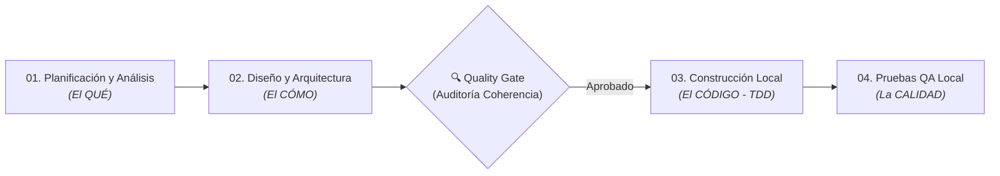

# Metodología de Desarrollo SDLC + Git Flow + IA — COMPUNEX B2B

> **Proyecto:** COMPUNEX B2B — Plataforma Mayorista de Hardware  
> **Alcance Metodológico:** Fases **01 a 04** (Planificación y Análisis → Diseño y Arquitectura → Construcción Local → Pruebas y Validación Local).  
> **Nota de Alcance:** Por definición del equipo, este repositorio documenta y ejecuta el ciclo de vida **hasta la Fase 04 (Pruebas y Validación Local)**.

---

## 🏛️ Gobernanza y Sistema Operativo

* [`AGENTS.md`](AGENTS.md): reglas adaptables para agentes, decisiones y fuentes de verdad.
* [`MEMORY.md`](MEMORY.md): **Bitácora Viva del Sistema y Memoria Continua.** Matriz de estado de las 4 fases, registro de deuda técnica y decisiones abiertas.

---

## 🗺️ Las 4 Fases del SDLC Aplicadas

| Fase | Directorio Principal | Entregables Clave | Estado Actual |
| :---: | :--- | :--- | :---: |
| **01** | [`01_Fase_Planificacion_y_Analisis/`](01_Fase_Planificacion_y_Analisis/README.md) | `README_RETO.md`, Catálogo `RF-001..010` / `RNF-001..004`, Viabilidad y Priorización MoSCoW. | ✅ Documentada |
| **02** | [`02_Fase_Diseno_y_Arquitectura/`](02_Fase_Diseno_y_Arquitectura/README.md) | `ARCHITECTURE.md` (Back, Front, BD, Seguridad, APIs), `DOMAIN.md`, `TECH_STACK.md`, `CONTRATOS_JSON.md` y `AUDITORIA_COHERENCIA_FASE1_A_FASE2.md`. | ✅ Documentada |
| **03** | [`03_Fase_Construccion_y_Desarrollo/`](03_Fase_Construccion_y_Desarrollo/README.md) | `BACKLOG_GENERAL.md`, `SPEC_TEMPLATE.md`, `.sprints_generales/` y seguimiento por área. | 🟡 Back-end avanzado (pendiente cierre de perfiles/BD y Front-end) |
| **04** | [`04_Fase_Pruebas_y_Validacion_Local/`](04_Fase_Pruebas_y_Validacion_Local/README.md) | Estrategia de pruebas, evidencias JUnit/Postman/E2E y validaciones locales. | ⬜ Pendiente de cierre QA |

---

## Reglas de aplicación

1. **Desarrollo local:** entorno local reproducible con H2 en memoria para pruebas unitarias/integración y base de datos local para ejecución.
2. **Coherencia proporcional:** todo requisito de Fase 01 tiene trazabilidad en Fase 02 (`AUDITORIA_COHERENCIA_FASE1_A_FASE2.md`).
3. **Arquitectura neutral y fiel al código:** la documentación refleja el código real implementado en `compunex-backend` y las decisiones vigentes del equipo.
4. **Cero invenciones:** no se declaran verificadas pruebas ni configuraciones que no hayan sido ejecutadas o confirmadas.
